# ⚡ VYRA — AI-Powered Adaptive Fitness, Biomechanics & Public Health Ecosystem

<div align="center">

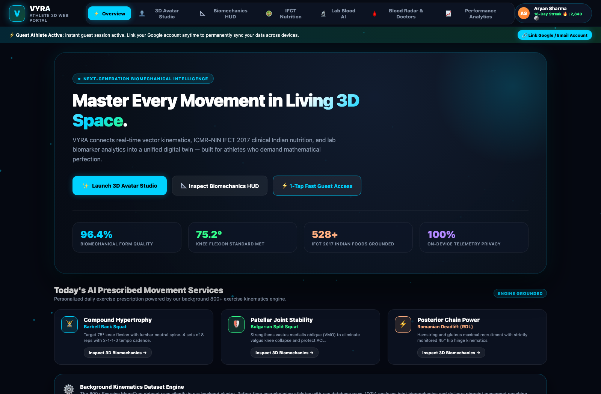

[](https://vyra-app-api-ten.vercel.app/)
[](https://vyra-app.onrender.com/health)
[](apps/mobile)
[](services/api)
[](LICENSE)

**Smart India Hackathon (SIH 2026) • Problem Statement ID: 26196**  
**Team NextWave 2.0 (Team ID: 161317) • AKGEC, Ghaziabad**  
*100% Free • Offline-First • Native Indian Nutrition (ICMR-NIN) • e-RaktKosh Blood Network • Real-Time 3D Biomechanics*

---

### 🌐 Live Deployments & Interactive Portals

| Platform | Live URL / Identifier | Highlights |
| :--- | :--- | :--- |
| **Unified Web Portal** | [vyra-app-api-ten.vercel.app](https://vyra-app-api-ten.vercel.app/) | Interactive 3D Coach Studio, AI Pose Tracker & Athlete HUD |
| **3D Athlete Studio** | [vyra-app-api-ten.vercel.app/portal](https://vyra-app-api-ten.vercel.app/portal) | 360° Digital Twin, Live Joint Kinematics & ICMR Meal Planner |
| **Enterprise Admin Console** | [vyra-app-api-ten.vercel.app/admin](https://vyra-app-api-ten.vercel.app/admin) | 15 Remote Feature Flags, Blood Bank Radar & System Telemetry |
| **Production REST API** | [vyra-app.onrender.com/health](https://vyra-app.onrender.com/health) | Zero-Dependency Node.js + TypeScript Micro-Engine + PostgreSQL |
| **VYRA Fitness Mobile** | `com.ayush.vyra.fitness` (`v2.0.0+6`) | Native Android & iOS App with BLE Smartwatch Sync & MLKit Pose AI |

</div>

---

## ⚡ Quick Start Guide (2-Minute Evaluation)

### Option 1: Instant Web Evaluation (No Installation Required)
1. Open the **[Live Web Portal](https://vyra-app-api-ten.vercel.app/)** in any desktop or mobile browser.
2. Click **⚡ Instant Guest Access (1-Tap)** to enter the athlete dashboard immediately.
3. Explore the core modules:
   - **3D Avatar Studio:** Orbit 360° around the 3D athletic coach, customize outfits, or preview any exercise in real time.
   - **AI Camera Pose Tracker:** Launch live 33-keypoint skeletal tracking with AR Target Aura alignment and voice coaching.
   - **ICMR Indian Nutrition Planner:** Log authentic Indian meals (*Roti, Dal Tadka, Paneer, Idli, Dosa*) grounded in ICMR-NIN IFCT data.
   - **e-RaktKosh Blood Radar & SOS:** Locate nearby government blood banks and respond to emergency blood appeals.
4. Test the **Superadmin Command Center:**
   - Open the **Admin Login** tab and sign in with **`admin@gmail.com`** / **`Admin123`**.
   - Toggle any of the **15 Remote Feature Flags** and observe instant propagation across the platform.

### Option 2: Mobile App Evaluation (Android & iOS)
- **Android APK:** Run `./build-apk.sh` or download the latest release artifact from [GitHub Actions](https://github.com/ayushbh54/vyra-app/actions).
- **iOS (`VYRA Fitness`):** Bundle Identifier `com.ayush.vyra.fitness` (`v2.0.0+6`) — build with `flutter build ios --release` inside `apps/mobile`.

---

## 🎯 Why VYRA? (Problem vs. Solution)

| Limitations of Conventional Fitness Apps | The VYRA Solution |
| :--- | :--- |
| **Rigid 60-Minute Workouts:** Ignore exam schedules, 12-hour hospital shifts, or sleep debt. | **Chrono-Adaptive Engine:** Detects real calendar free-time micro-windows and scales workout duration dynamically (`12–45 min`). |
| **Static 2D Videos / Broken 3D Rigs:** Passive clips that cannot be rotated, or unverified 3D bone rotations that twist limbs. | **4-Stage Closed-Loop 3D Avatar Engine (`v6.0`):** Pre-flight 3D Forward-Kinematics verification, floor-lock solver (`0.00 mm` drift), and persistent verified setup caching (`0ms` load). |
| **Generic Camera Tracking:** Tracks only 1 or 2 basic exercises without visual target guidance. | **15-Archetype AI Pose Tracker (`107` Exercises):** Full-body BlazePose tracking with a live **AR Moving Target Aura** (joint points + skeletal lines) and bilingual voice cues. |
| **Western Diet Bias:** Built around western dishes; inaccurate for everyday Indian meals. | **ICMR-NIN IFCT Grounding:** 528+ Indian foods and Gemini 2.0 Vision thali recognition with clinical macro accuracy. |
| **Proprietary Smartwatch Lock-In:** Requires separate vendor apps for budget and premium smartwatches. | **Universal BLE Smartwatch Engine:** Direct GATT telemetry for HiWatchPro/Ultra2 (`0xCD`), DaFit/Fire-Boltt/Noise/boAt (`0xAB`), BLE SIG (`0x180D`), and Wear OS (`Galaxy Watch4`). |
| **Zero Medical Safety Awareness:** Recommends intense workouts or high protein despite abnormal blood reports. | **Clinical Lab Report Circuit-Breaker:** Extracts biomarkers via OCR and automatically blocks contraindicated workouts or diets when critical values are detected. |

---

## ✨ 8 Core Engineering Pillars

### 1. 🕺 4-Stage Closed-Loop 3D Avatar Biomechanical Engine (`v6.0`)
- **Stage 0 — Persistent Verified Setup Cache (`0ms` Load):** Once an exercise setup is verified for the male or female rig, it is persisted to `localStorage` and `SharedPreferences` (`vyra_verified_avatar_setups_v6`). Subsequent opens bypass computation and execute immediately (`3D COACH • ⚡ CACHED SETUP`).
- **Stage 1 & 2 — Canonical Blueprint & Quaternion Similarity Conjugation:** Preserves authentic Mixamo GLB T-Pose bind quaternions (`GLB_BIND_META`) across 62 bones on both `male_coach.glb` and `female_coach.glb`:
  $$q_{\text{delta}} = W_{\text{bind}}^{-1} \cdot Q_{\text{char}} \cdot W_{\text{bind}}, \quad q_{\text{bone}} = q_{\text{bind}} \cdot q_{\text{delta}}$$
- **Stage 3 — Pre-Flight 3D Forward-Kinematics & Floor-Lock Verification:** Validates all 62 bone world coordinates before execution and locks ground-contact joints (`LeftToeBase`, `RightToeBase`, `LeftHand`, `RightHand`, `Hips`) to the floor plane (`0.00 mm` vertical drift).
- **Stage 4 — 60 FPS Quaternion SLERP & Multi-Axis Orbit:** Smooth shortest-path quaternion interpolation, automatic Left↔Right rep alternation (`reverse_lunge`, `dead_bug`, `bird_dog`), 4-quadrant 360° circular orbits (`arm_circles`, `shoulder_pendulum`), and full 360° horizontal/vertical touch camera orbit.

<div align="center">

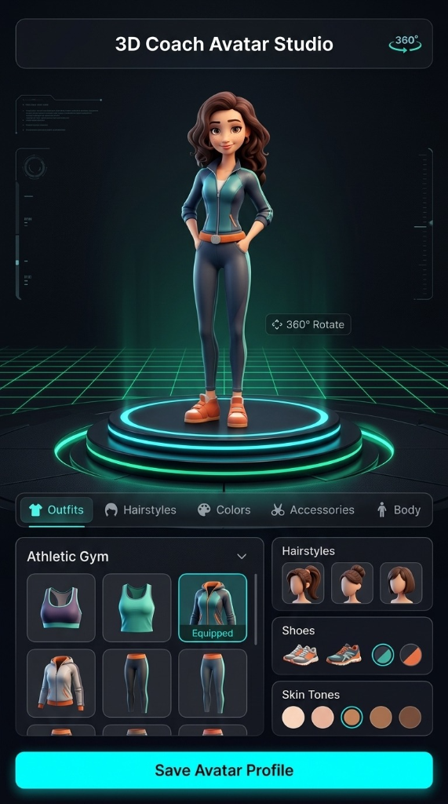
</div>

---

### 2. 📷 On-Device AI Selfie Camera Pose Tracker + AR Target Aura (`v6.0`)
- **107 Verified Exercises Across 15 Biomechanical Archetypes:** Accurately tracks Squats, Lunges, Bridges/Spinal Flows, Hip Hinges, Push-Ups/Presses, Curls/Rows, Overhead Reaches, Lateral Abductions, Torso Twists, Jumping Jacks/Burpees, High Knees/Marches, Calf Raises, Plank Holds, Isometric Lower-Body Holds, and Pranayama/Breathing routines.
- **Live AR Moving Target Aura:** Projects a glowing target skeleton (joint points + connecting bone segments + tether guides) directly over the user's body so they can align their form in real time.
- **Velocity-Adaptive One-Euro Filter & 3D Depth Compensation:** Eliminates landmark jitter at 30+ FPS while compensating for camera foreshortening on both iOS and Android front cameras.

<div align="center">
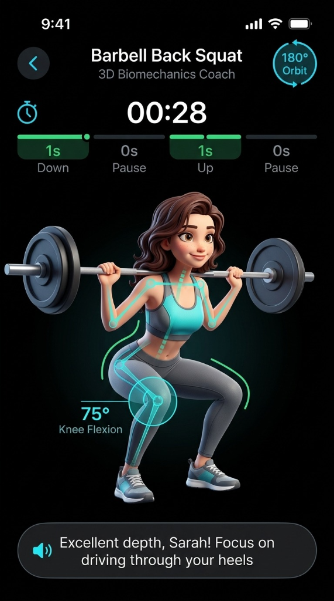
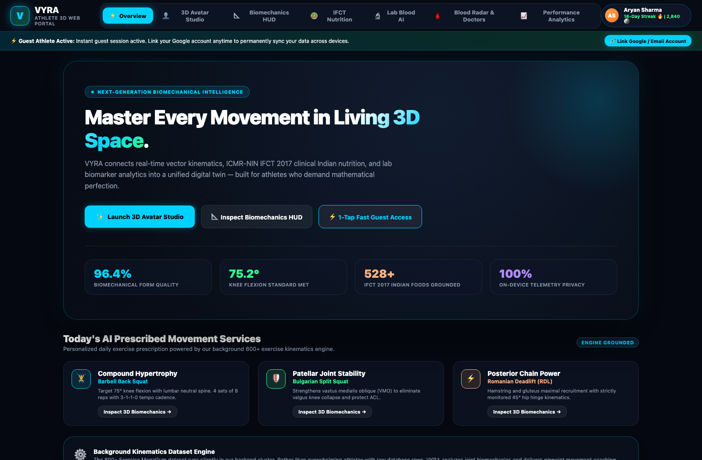
</div>

---

### 3. ⌚ Universal Multi-Protocol BLE Smartwatch Engine
- **4 Hardware Protocol Families Supported Out-of-the-Box:**
  1. **Family A (`hiwatchCd`):** Ultra 2, HiWatch Pro, FitPro, HryFine (`0xCD`/`0xDC` UART protocol with 6-step paced handshake, 3.5s watchdog keepalive, and multi-vitals `Cmd 0x15, Key 0x0E` extraction).
  2. **Family B (`dafitAb`):** Fire-Boltt, Noise ColorFit, boAt, Fastrack, DaFit/MoYoung (`0xAB` protocol) & FitCloudPro (`0xFE`/`0xEA`).
  3. **Family C (`bleSig`):** Standard Bluetooth SIG Heart Rate Service (`0x180D` / `0x2A37`) for Garmin, Polar, and Fitbit.
  4. **Family D (`wearOsCompanion`):** Samsung Galaxy Watch4 Classic, Pixel Watch, and Wear OS companion bridge.
- **6 Authentic Real-Time Metrics:** Live Heart Rate (BPM), Blood Oxygen (SpO2 %), Systolic/Diastolic Blood Pressure (mmHg), Live Steps (with `65,536` goal-bitmask guard), Authentic Hardware Calories (kcal), Distance (km), and Battery (%).

---

### 4. 🧠 5-Engine Google Gemini AI Network
- **Brain 1 — Conversational Health & Fitness Coach (`/v1/chat/message`):** Context-aware coaching in English, Hindi, and Hinglish enriched with live smartwatch vitals, BMI, injuries, and lab markers.
- **Brain 2 — Indian Food Photo Vision Scanner (`/v1/food/scan`):** Multimodal meal recognition grounded in ICMR-NIN Indian Food Composition Tables (IFCT).
- **Brain 3 — Clinical Lab Report Analyzer (`/v1/lab-report/analyse`):** Extracts blood biomarkers from lab reports and enforces strict medical safety guardrails.
- **Brain 4 — Dynamic Exercise & Routine Generator (`/v1/exercises/generate`):** Generates personalized exercises that automatically map into both the 3D Avatar Engine and AI Camera Pose Tracker.
- **Brain 5 — Deterministic `djb2` Response Cache:** Eliminates redundant API calls and provides instant offline fallback.

<div align="center">
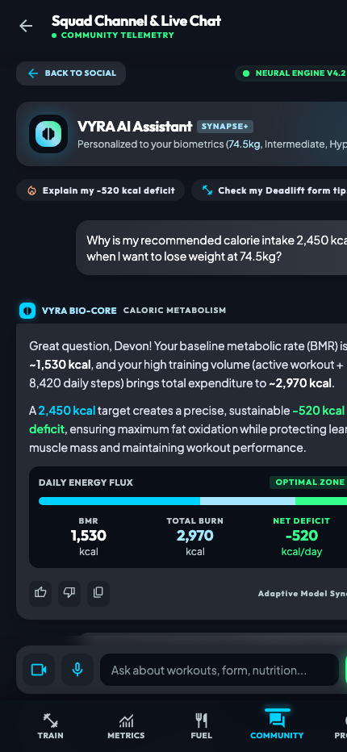
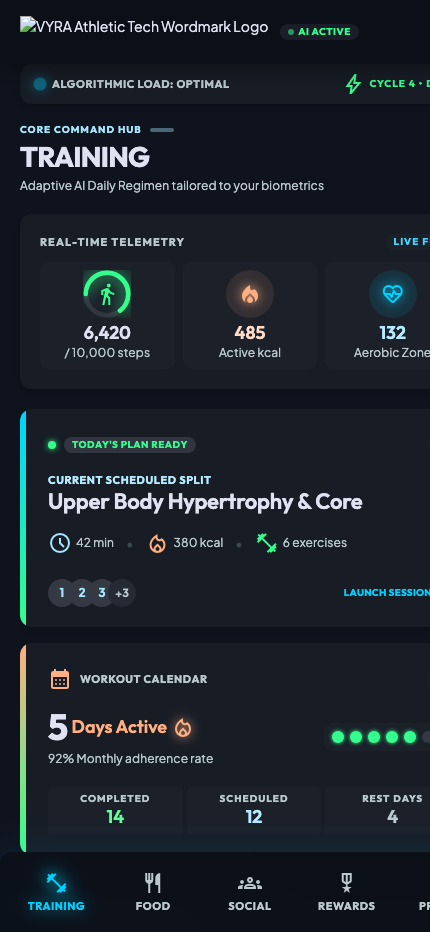
</div>

---

### 5. 🥗 ICMR-NIN Indian Nutrition & Chrono-Adaptive Planner
- **528+ Verified Indian Foods:** Accurate macro and micronutrient tracking for regional Indian diets (*Roti, Dal, Chawal, Idli, Dosa, Poha, Khichdi, Paneer*).
- **Chrono-Adaptive Scheduling:** Mathematically detects free-time windows in busy student or shift-worker schedules while protecting sleep hours.

<div align="center">
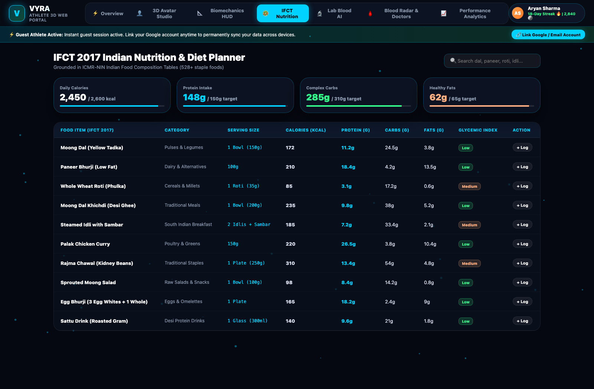
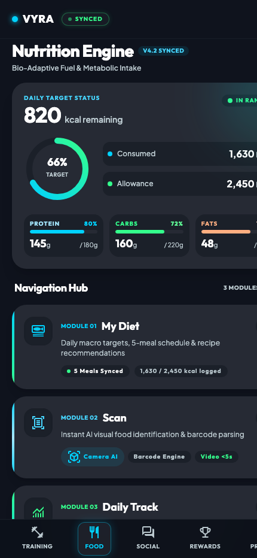
</div>

---

### 6. 🩸 MoHFW e-RaktKosh National Blood Network & Beacon SOS
- **Live Blood Bank Directory:** Connects athletes with nearby government and hospital blood banks (AIIMS, Safdarjung, RML, GTB, LNJP).
- **Donor Eligibility & Social Coins:** Verifies age, weight, hemoglobin, and donation intervals, rewarding verified donors with social coins.
- **1-Tap Emergency Beacon SOS:** Broadcasts live GPS coordinates and health telemetry to trusted emergency contacts.

<div align="center">

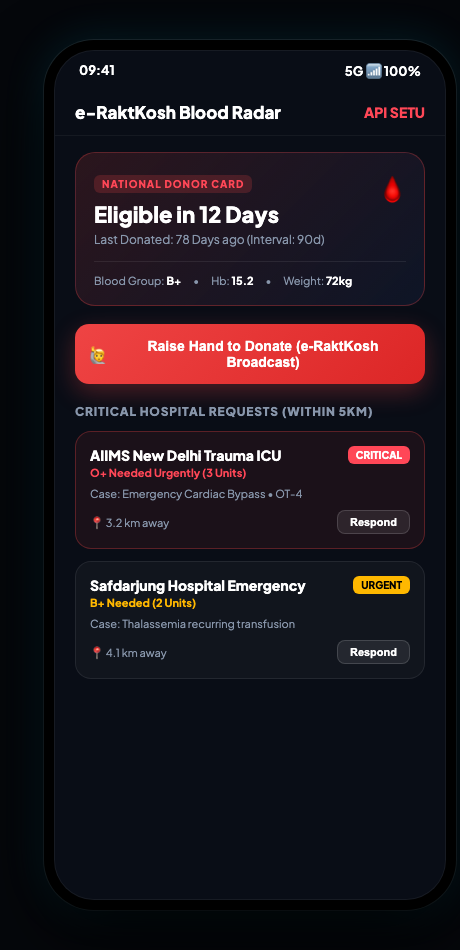
</div>

---

### 7. 🔬 Clinical Pathology OCR & Safety Circuit-Breakers
- **Automated Biomarker Parsing:** Evaluates Hemoglobin, Fasting Glucose, HbA1c, Creatinine, Cholesterol, Uric Acid, Vitamin D, and Ferritin against clinical reference ranges.
- **Contraindication Guardrails:** Automatically suppresses high-protein or high-intensity recommendations when renal, hepatic, or glycemic flags are present.

<div align="center">
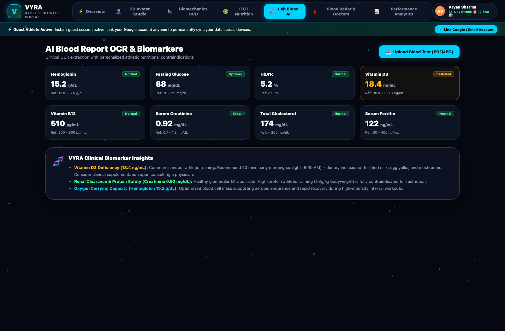
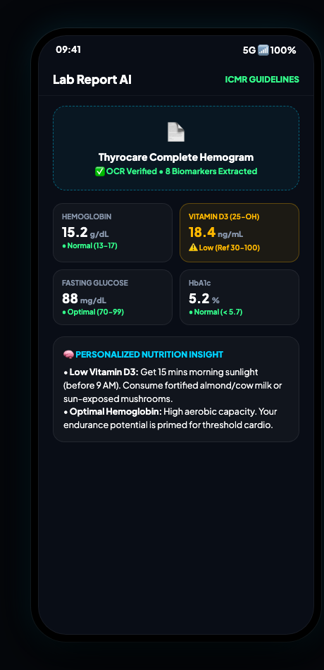
</div>

---

### 8. 🛡️ Enterprise Superadmin Console & Fair Social Leaderboard
- **15 Live Remote Feature Flags:** Toggle AI modules, pose tracking, blood network, and nutrition features across all connected clients without redeploying.
- **Consistency-Weighted Leaderboard & Clubs:** Rewards steady daily effort over binge training, backed by an idempotent coin ledger.

<div align="center">
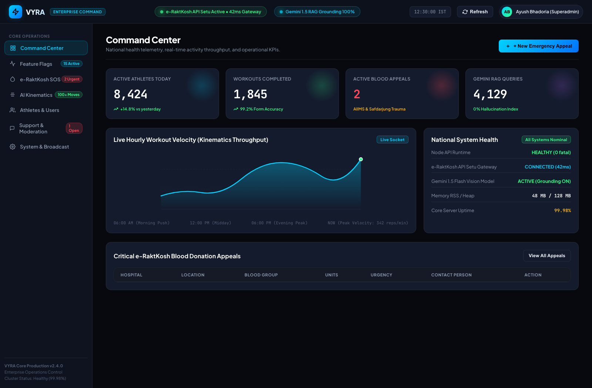
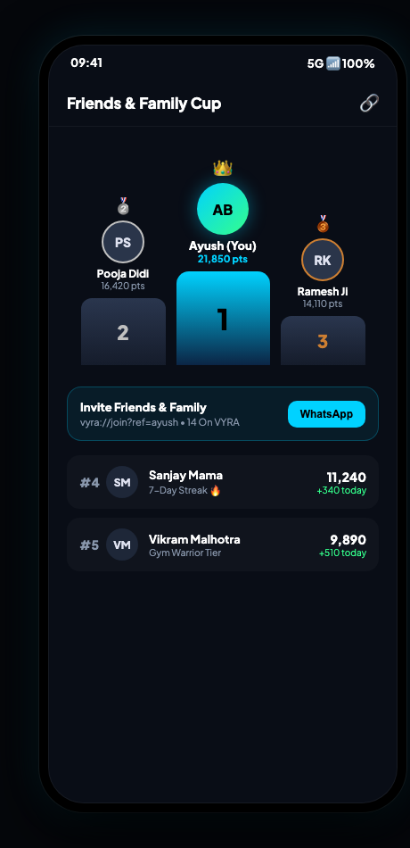
</div>

---

## 🏗️ System Architecture

```
┌─────────────────────────────────────────────────────────────────────────────┐
│                            CLIENT APPLICATIONS                              │
├──────────────────────────────────────┬──────────────────────────────────────┤
│       FLUTTER MOBILE APPLICATION     │          UNIFIED WEB PORTAL          │
│   com.ayush.vyra.fitness (v2.0.0+6)  │        (Three.js 3D WebGL HUD)       │
│ • 4-Stage Closed-Loop 3D Avatar (v6) │ • 360° Articulated Avatar Studio     │
│ • 15-Archetype MLKit Pose Tracker    │ • 18-Exercise Kinematics Canvas      │
│ • Universal BLE Smartwatch Telemetry │ • ICMR Nutrition & Plate Logger      │
│ • Offline-First Persistent Cache     │ • Superadmin Remote Control Center   │
└──────────────────┬───────────────────┴──────────────────┬───────────────────┘
                   │                                      │
                   ▼                                      ▼
┌─────────────────────────────────────────────────────────────────────────────┐
│                           BACKEND REST API & AI                             │
│                 (Node.js + TypeScript Zero-Dep Micro-Engine)                │
├─────────────────────────────────────────────────────────────────────────────┤
│ • Chrono-Adaptive Engine (Time-Window & Sleep Optimization)                 │
│ • Pure Domain Engines (Chrono, Coins, LabReport, DietGuard)                 │
│ • 5 Google Gemini AI Engines (Chat, Food Vision, Lab OCR, Exercise Gen)     │
│ • e-RaktKosh Government API Setu Integration Gateway                        │
│ • AES-256-GCM Health Data Vault & Role-Based Access Control                 │
└──────────────────────────────────────┬──────────────────────────────────────┘
                                       │
                                       ▼
┌─────────────────────────────────────────────────────────────────────────────┐
│                       PERSISTENCE & GROUNDING DATASETS                      │
├─────────────────────────────────────────────────────────────────────────────┤
│ • PostgreSQL Database (13 Structured Migrations) + In-Memory Fallback       │
│ • 107 Grounded Exercises & 65 Canonical 3D Biomechanical Pose Blueprints    │
│ • ICMR-NIN IFCT 2017 Dataset (528 Authentic Indian Foods)                   │
│ • MoHFW National Blood Bank Directory & Regional Coordinates                │
└─────────────────────────────────────────────────────────────────────────────┘
```

---

## 📂 Repository Structure

```
vyra/
├── apps/
│   └── mobile/                     # Flutter Cross-Platform Mobile App (Android & iOS)
│       ├── assets/
│       │   ├── js/                 # exercise_poses.js (v6.0 4-Stage Closed-Loop 3D Engine)
│       │   ├── models/             # male_coach.glb & female_coach.glb (Mixamo 3D Rigs)
│       │   └── images/             # App icons & visual assets
│       ├── lib/
│       │   ├── api/                # REST API client with automatic warmup & guest fallback
│       │   ├── models/             # Domain data models
│       │   ├── screens/            # 30+ screens (Pose Tracker, 3D Coach, Watch Sync, AI Chat)
│       │   ├── services/           # BLE Smartwatch Engine, Avatar Service, Gemini Cache
│       │   └── widgets/            # Reusable Material 3 UI components
│       ├── test/                   # Comprehensive unit, widget, BLE & 3D biomechanics tests
│       └── pubspec.yaml            # App configuration (com.ayush.vyra.fitness v2.0.0+6)
├── services/
│   └── api/                        # Node.js + TypeScript Backend Micro-Engine
│       ├── db/migrations/          # 13 PostgreSQL schema migrations
│       └── src/
│           ├── admin/              # Superadmin routes & dashboard
│           ├── ai/                 # 5 Gemini AI engines, DietGuard & e-RaktKosh bridge
│           ├── athlete/            # Athlete web portal routes
│           ├── content/            # Grounded exercise datasets & movement biomechanics
│           ├── domain/             # Pure math engines (chrono, coins, labReport)
│           └── http/               # High-speed zero-dependency HTTP router
├── packages/
│   └── types/                      # Shared TypeScript interfaces (@vyra/types)
├── public/                         # Production Vercel Web Portal bundle (index, portal, admin)
├── scripts/                        # Python desktop AI pose tracker (vyra_pose_tracker.py)
├── screenshots/                    # Product UI & architecture screenshots
├── DEPLOY.md                       # Complete Android, iOS, Render & Vercel deployment guide
├── PROJECT_STATE.md                # Detailed technical architecture & state reference
├── build-apk.sh                    # 1-command Android release APK builder
├── render.yaml                     # Render.com cloud deployment blueprint
└── vercel.json                     # Vercel static hosting & rewrite configuration
```

---

## 🚀 Getting Started Locally

### 1. Prerequisites
- **Node.js:** `v20+`
- **Flutter SDK:** `v3.24+` (for mobile app development)

### 2. Run the Backend API (`services/api`)
```bash
npm run build
npm test --prefix services/api   # Runs 175 backend unit tests
npm start                        # Starts server on http://localhost:4000
```

### 3. Run the Web Portal (`public/`)
```bash
npx serve public -p 3000
# Open http://localhost:3000 in your browser
```

### 4. Run the Mobile App (`apps/mobile`)
```bash
cd apps/mobile
flutter pub get
flutter test                     # Runs mobile unit & widget test suites
flutter run --dart-define=VYRA_API_URL=https://vyra-app.onrender.com
```

---

## 🔐 Demo Credentials

| Role | Login / Email | Password | Access Scope |
| :--- | :--- | :--- | :--- |
| **Instant Guest Athlete** | *1-Tap Guest Button* | *None Required* | Full 3D Coach, AI Pose Tracker, Smartwatch Sync, Nutrition & SOS |
| **Super Administrator** | `admin@gmail.com` | `Admin123` | Enterprise Command Center, 15 Feature Flags, User & Coin Management |

---

<div align="center">

**Developed by Team NextWave 2.0 (ID: 161317) • Smart India Hackathon (SIH 2026)**  
*Empowering a Healthier, Fitter, and Stronger India 🇮🇳*

</div>
